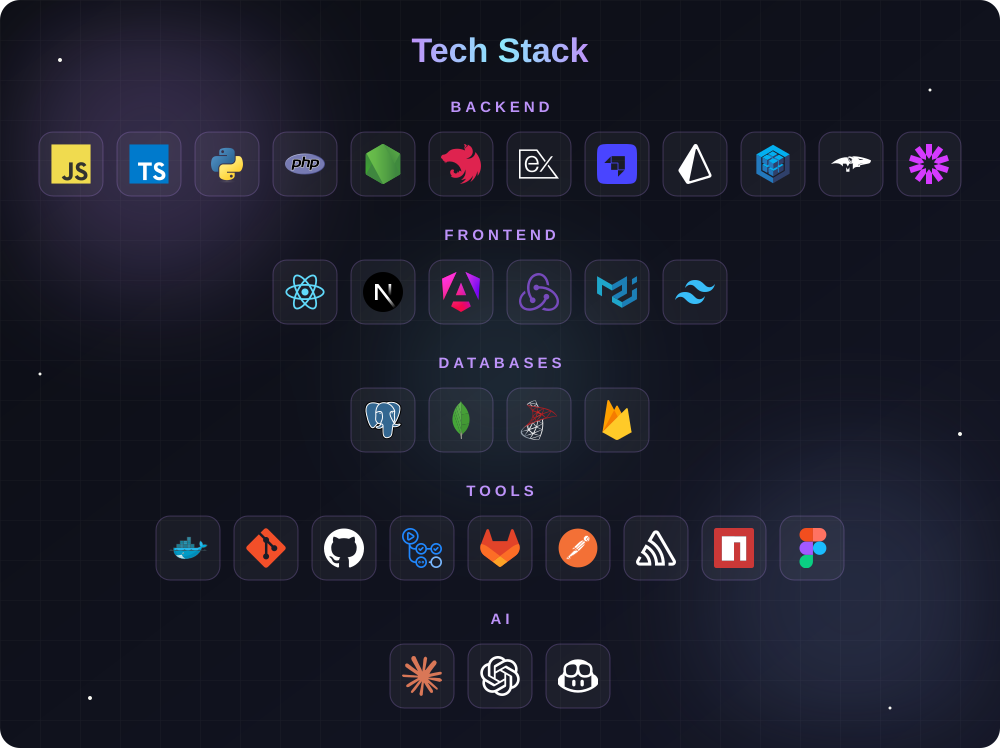

  

  

  
  
  
  

  I'm Ziad Hosny, a Full-Stack Software Engineer based in Egypt with 5+ years of experience. 
  I build scalable backends with Node.js, NestJS, and PostgreSQL, and modern frontends with React, Next.js, and TypeScript. 
  I also make Arabic content about software engineering.

<h3 align="center">Watch</h3>

  

<h3 align="center">Featured Projects</h3>

- **[Quran Kareem](https://quran-app-z.vercel.app/)**: Quran recitations by famous reciters on web, mobile, and Android TV. MERN, Redux, MUI
- **[Pro Shop](https://pro-shop-z.vercel.app/)**: E-commerce platform. MERN, Redux
- **[Advanced Audio Player](https://advancedaudioplayer.netlify.app/)**: Shuffle, repeat, and loop a selected part N times. MERN

  

  Thanks for stopping by 👋

  

